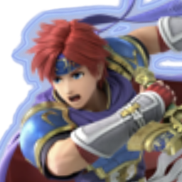
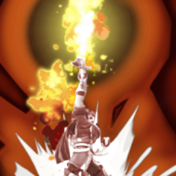
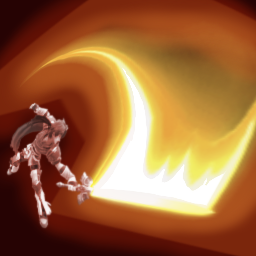
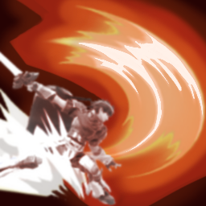
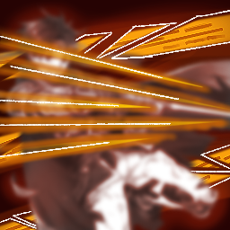
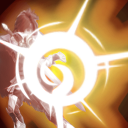

# Roy — a Risk of Rain 2 survivor mod

A playable **Roy** (Fire Emblem: The Binding Blade / Super Smash Bros.) for Risk of Rain 2, with a melee kit built around Smash's
moveset and a flame meter that rewards aggressive, well-timed play. Personal, non-commercial fan project.

This repository holds the **mod's source code and original art**. The character model, animations, textures and sound
effects come from Nintendo's games and are not included (see [What's not here](#whats-not-here)).

## The kit

| | Skill | What it does |
|---|---|---|
|  | **Flame Meter** (passive) | Double-Edge Dance, Blazer, perfect dodges and counters fill the meter, raising damage by up to 50%. At half, the blade is **enflamed** and every hit ignites. Sword hits up close (the base of the blade) deal +25% damage with +25% crit chance. |
|  | **Sword of Seals** | Context-sensitive string: knee, jab, forward smash; hold to loop jab/tilt; dash slash while sprinting; two-hit spinning slash in the air. |
|  | **Double-Edge Dance** | Up to four slashes with three routes: ground, an air juggle (in the air or by jumping out of the string), and a dash route that pulls enemies in and finishes with a flurry of stabs that scales with attack speed. |
|  | **Evade** | Spot dodge, directional rolls (chain two into a sprint) or an air dodge with aerial follow-ups, including **Blazer** (hold forward to send it across). A perfect dodge strikes back and engulfs the attacker in a pillar of fire. |
|  | **Counter** | Counter stance. A block strikes back and leaves a fire pillar; a perfect counter rushes Roy to the attacker, on the ground or in the air, for a Final Smash and a fire tornado. |

## Highlights

- **State-machine kit** on top of RoR2's entity states, with input buffering, combo windows, cancel rules and per-move hitbox groups
  (`RoyMod/Characters/Survivors/Henry/SkillStates/Roy`).
- **Incoming-hit interception** for i-frames, perfect dodges and counters (`RoyController` + `IRoyDefensive`).
- **Flame meter HUD and crosshair** drawn from original art (`RoyMeterHud`, `Art/UI`).
- **Flaming blade** with a blade-wide swing trail (`RoyFlameSword`, `RoySwordTrail`) and fire pillar / tornado damage zones (`RoyFireZone`).
- **Verlet cloth** for the headband and cape (`RoyHeadband`), plus facial expressions driven by gameplay (`RoyFace`).
- **Fire Emblem-style death**: hurt pose, fade to white, dissolve (`RoyDeathState`).
- **Wwise audio**: sounds are built into a Wwise sound bank, embedded in the dll and loaded through R2API's SoundAPI (`RoySound`).
- Custom spawn entrance, an unlockable Awakening skin, item display rules and Smash-style hitbox tuning throughout.

## Repository layout

| Folder | Contents |
|---|---|
| `RoyMod/` | The BepInEx plugin (C#, .NET Standard). |
| `UnityScripts/` | Editor-side scripts used to preview animations, cloth and effects in Unity. |
| `Icons/` | Portrait and skill icons (original art). |
| `Art/UI/` | Flame meter sword and ring crosshair (original art). |
| `Art/VFX/` | Flame and warp textures made for the mod's effects. |

## Building

Requires the .NET SDK. Run `dotnet build -c Release` in `RoyMod/`; NuGet pulls the Risk of Rain 2 libraries.
The game-side assets (`roybundle` asset bundle and `RoyBank` Wwise sound bank) are not in this repository, so a fresh build
compiles but has no model or sound.

## What's not here

The Roy model, animations and textures, and the Smash Bros. / Fire Emblem sound effects belong to Nintendo, so the Unity
asset project, the built asset bundle and the Wwise project with its audio are kept out of this public repository.

## Credits

- Built on the [Henry tutorial template](https://github.com/ArcPh1r3/HenryTutorial) by ArcPh1r3 and contributors (the
  `Henry` names in the code come from it).
- Uses [BepInEx](https://github.com/BepInEx/BepInEx) and [R2API](https://github.com/risk-of-thunder/R2API).
- Roy and Fire Emblem are © Nintendo / Intelligent Systems. Risk of Rain 2 is © Hopoo Games / Gearbox. This is an unofficial fan project.
